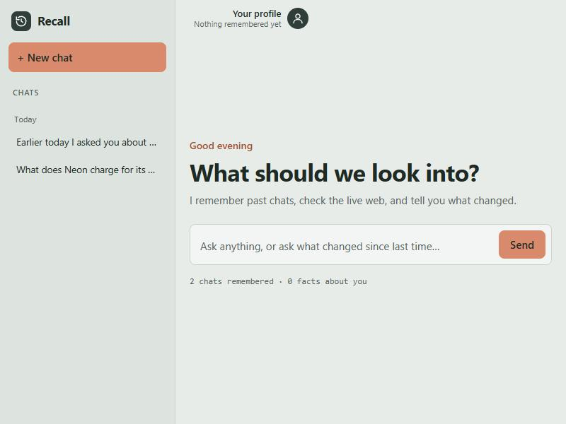
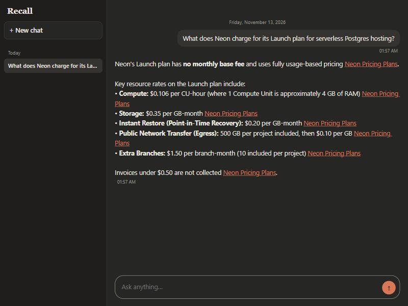
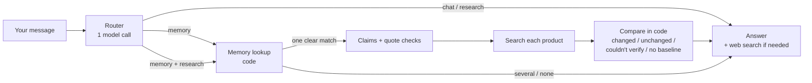

# Recall

A chat agent that **remembers your past conversations, checks the live web, and tells you what changed since** — and says so plainly when it can't compare, instead of guessing.

Most chatbots can search the web, but they can't connect *"what you asked me last Tuesday"* to *"what's true today"*. Recall can:

> **You:** Earlier today I asked you about Neon pricing. Has anything changed since then?
>
> **Recall:** The monthly base fee, storage rate, and data egress allowance for Neon's Launch plan are unchanged since earlier today (…from a web search), but compute, instant restore, and extra branch rates **could not be verified**.



## What it does

| You ask | What Recall does |
| --- | --- |
| "What does Neon charge for Postgres hosting?" | Searches the web and answers with clickable source links. |
| "Has any of that changed since I asked on Monday?" | Finds that earlier conversation, re-checks each fact, and reports **changed / unchanged / couldn't verify / no baseline**, with sources. If there is no record of that chat, it says so first, then searches what changed on the web since that date. |
| "Did we ever talk about Uganda?" | Lists every earlier chat that mentions it, with times and your exact words. |
| "No, that's not the one I meant" | Excludes that conversation and tries the next candidate; after a second miss it asks which one you mean. |
| "I'm Alex, I run sales for a 20-person team and I prefer short answers" | Remembers it, tailors this and every later answer to you (a pricing question comes back as a cost for 20 seats), and greets you by name. See [Personalisation](#personalisation). |
| "What is the capital of France?" | Answers directly. No search, no memory lookup. |




The worst failure for an assistant like this is **inventing a past that never happened**, so Recall never does: a baseline must be a verbatim quote from a stored message, and a current value must be a verbatim quote from a real search result. If it can't prove it, it says "no record" or "couldn't verify".

## Personalisation

Recall remembers what you tell it about yourself and uses it to tailor answers:

- **Facts you state** ("I'm Alex", "we're a 20-person team", "my budget is 500 a month", "I'm based in Lisbon", "I prefer short answers") are saved automatically and used in every later chat, so you never repeat them. It also greets you by name.
- **Local context.** A saved currency or region steers how prices are shown. Recall never converts currencies from memory: if a source only gives another currency, it shows that and says so.
- **Tone and format.** A stated preference for short answers, bullets or detail is followed.
- **You stay in control.** Under each reply Recall says what it just remembered, with **Undo**. **What I know about you** (bottom of the sidebar) lists every saved fact: edit one, delete one, add one by hand (for example *Team size: 20 people*), or forget everything. Facts you add by hand go through the same safety checks.

How it stays trustworthy: nothing is inferred. The router that already reads each message proposes facts you stated, and code keeps one only if it is a **verbatim quote** from your message, is short, and does not look like a secret, an email or an ID number (passwords, API keys, card or phone numbers and health details are never stored). That costs **no extra model call**. Facts live in `data/profile/facts.json` on your machine (git-ignored); a newer statement replaces an older one for the same key.

## Run it

You need a recent Node.js (developed and tested on Node 24; there is no build step).

```bash
npm install
cp .env.example .env     # then paste your free key after GEMINI_API_KEY=
npm run dev              # http://localhost:3000
```

Get a free Gemini key at <https://aistudio.google.com/apikey>. Search needs **no key**. The server reads `.env` only at startup, so restart it after changing it.

**Try it:** ask something current, press **New chat**, then ask "has that changed since I asked you earlier?". The sidebar keeps your past chats; open one to continue it.

### Configuration

| Variable | Required | Default | Purpose |
| --- | --- | --- | --- |
| `GEMINI_API_KEY` | yes | | Free key from Google AI Studio |
| `GEMINI_MODEL` | no | `gemini-3.5-flash-lite` | Run `npm run check:models` to see what your key can use |
| `PARALLEL_API_KEY` | no | | Higher limits on the hosted search server; works without it |
| `SEARCH_MCP_URL` | no | `https://search.parallel.ai/mcp` | Search server (MCP over HTTP) |
| `PORT` | no | `3000` | |
| `DATA_DIR` | no | `data` | Where conversations are stored as JSON |

### Commands

| Command | What it does |
| --- | --- |
| `npm run dev` | Start the server with auto-reload |
| `npm test` | Unit tests (no network or key needed) |
| `npm run typecheck` | TypeScript check |
| `npm run ping:model` | One tiny model call with timings; tells key/network problems apart from app problems |
| `npm run check:models` | Lists the models your key can call |
| `npm run probe:search` | Connects to the search server and prints its tools and a sample result |

**Troubleshooting.** If the configured model isn't available for your key, Recall switches to the newest flash-lite model your key can use and logs the switch; to choose one yourself, pick from `npm run check:models` and set `GEMINI_MODEL`. Free-tier rate limits and Google's occasional "high demand" errors are retried automatically and otherwise shown with Google's own reason.

## How it works



The principle: **code is the librarian, the model is the reader.** The model has no memory, so anything that must be exact is done in code: date arithmetic, finding the right conversation, quoting you verbatim, search limits, provenance, and the verdicts. The model only classifies the message, reads old answers into claims, and writes the final reply. Every model output that gates behaviour is validated, and anything that fails verification is dropped, not repaired.

A casual chat costs 2 model calls; a then-versus-now check costs 3 (4 the first time). The full reasoning, the options rejected and the known limits are in **[DESIGN.md](DESIGN.md)**.

## Project layout

```
src/
  server.ts            entry point: config, wiring, listen
  app.ts               HTTP server: /api/chat (streamed), /api/conversations, static files
  config.ts            env loading with clear errors
  adapters/
    llm.ts             Gemini: streaming, tool calls, JSON output, retries and timeouts
    search.ts          Parallel Search over MCP, plus a result cache
    errors.ts          turns Google's raw errors into readable ones
  agent/
    pipeline.ts        one turn, end to end
    router.ts          classify the message and spot facts about you (1 model call)
    personalize.ts     which proposed facts are kept (verbatim quote, no secrets) and how the model sees them
    claims.ts          old answers -> verified claims
    compare.ts         then vs now: verification and verdicts, in code
    research.ts        bounded search loop (2 searches per turn)
    prompt.ts          system prompt
  memory/
    store.ts           one JSON file per conversation
    dates.ts           "last Tuesday" -> ranked candidate days (injectable clock)
    recall.ts          find the conversation you mean
    profile.ts         the facts you told Recall about yourself (viewable, editable)
public/                the chat page: landing screen, history sidebar (no build step)
scripts/               ping-model, check-models, probe-search
test/                  unit tests with fake models and a fake search
```

## Limits

Real runs cover a handful of conversations, not an evaluation set. Search turns take roughly 11 to 22 seconds on the free tier. A chat is titled by its first message, and the sidebar has no delete or rename yet. See the *Known limits* section of [DESIGN.md](DESIGN.md) for the full list.
